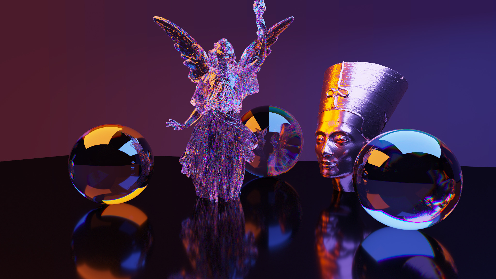
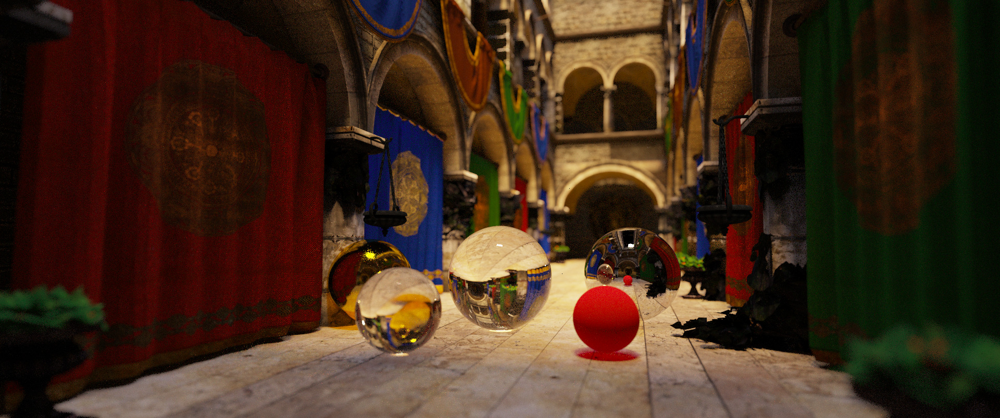
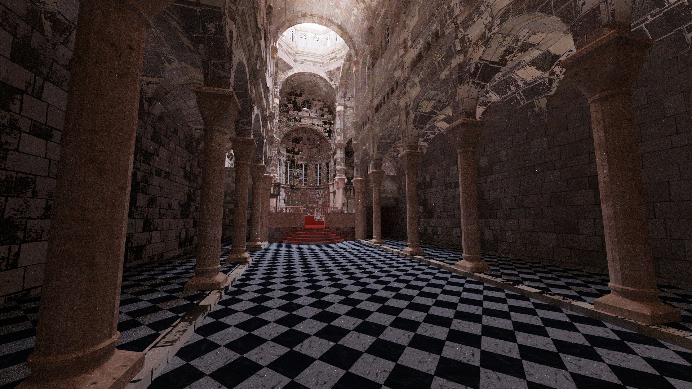
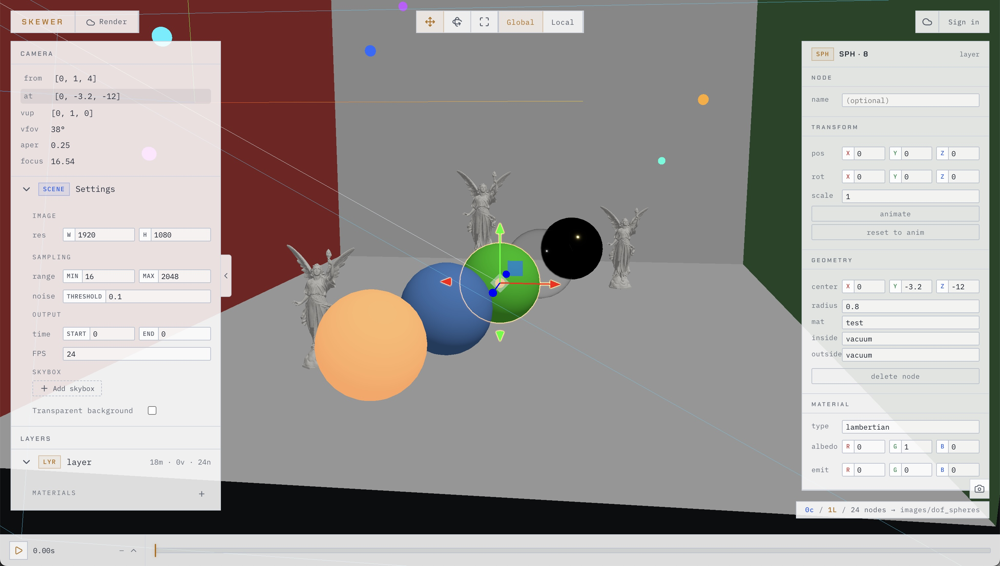

# Skewer

A physically based spectral path tracer and serverless render farm. Scenes are split into layers, rendered in parallel on Google Cloud, and merged back together with deep compositing.

**[Documentation](https://skewer-project.github.io/skewer/)** · **[Scene Previewer](https://skewer.pages.dev)**

  
   
  <em>Spectral dispersion: a crystal Lucy and glass spheres split light into its colours. 1920×1080, up to 131k samples per pixel.</em>

## Highlights

- **Spectral path tracing** with hero-wavelength sampling, wavelength-dependent dispersion, and Lambertian, metal and dielectric materials
- **Two-level BVH** (BLAS/TLAS) acceleration with instancing
- **Volumetric rendering** of NanoVDB clouds using delta and ratio tracking
- **Deep EXR output**, plus a deep-image merger (`loom/`) that combines independently rendered layers by depth
- **Adaptive sampling** that stops refining each pixel once it converges
- **Keyframe animation** with motion blur
- **Serverless GCP pipeline:** Cloud Run → Cloud Workflows → Cloud Batch, provisioned with Terraform
- **Web scene previewer** for editing scenes and submitting cloud renders

## Gallery

<table>
  <tr>
    <td align="center" width="50%"> <em>Crytek Sponza: global illumination, depth of field, glass and metal</em></td>
    <td align="center" width="50%"> <em>Šibenik Cathedral: a large interior lit entirely by bounced light</em></td>
  </tr>
</table>

## Scene Previewer

A web app for building scenes in the browser: place and transform objects in a live 3D viewport, edit cameras, materials and render settings, keyframe animation on a timeline, and submit the scene to the cloud render farm. Try it at [skewer.pages.dev](https://skewer.pages.dev) (requires a Chromium-based browser such as Chrome or Edge).

  

## For Developers

- **`skewer/`** — C++ ray-tracing deep renderer
- **`loom/`** — C++ deep EXR merger used by the render pipeline (separate from the [Loom node-based compositor](https://github.com/skewer-project/loom), a Vulkan desktop app)
- **`orchestration/`** — Go CLI and Cloud Run Coordinator
- **`libs/exrio/`** — Shared deep EXR helpers

### Quick Start

1. Set up dependencies — see the [Installation guide](https://skewer-project.github.io/skewer/getting-started/installation/)
2. Build with CMake: `cmake --preset relwithdebinfo && cmake --build --preset relwithdebinfo --parallel 4`
3. Or follow the [GCP Deployment guide](https://skewer-project.github.io/skewer/getting-started/gcp/) for cloud rendering
4. Open the [Scene Previewer](https://skewer.pages.dev) and render your first scene

### Key Docs

| Guide | Link |
|---|---|
| Quick Start | [skewer-project.github.io/skewer/getting-started/quick-start/](https://skewer-project.github.io/skewer/getting-started/quick-start/) |
| CLI Reference | [skewer-project.github.io/skewer/reference/cli/](https://skewer-project.github.io/skewer/reference/cli/) |
| Scene Format | [skewer-project.github.io/skewer/reference/scene-format/](https://skewer-project.github.io/skewer/reference/scene-format/) |
| Rendering Tips | [skewer-project.github.io/skewer/reference/rendering-tips/](https://skewer-project.github.io/skewer/reference/rendering-tips/) |
| Architecture Overview | [skewer-project.github.io/skewer/developer/overview/](https://skewer-project.github.io/skewer/developer/overview/) |
| Full docs index | [skewer-project.github.io/skewer](https://skewer-project.github.io/skewer) |

### Infrastructure

Infrastructure is managed via **Terraform** in [`deployments/terraform/`](deployments/terraform/). CI/CD is handled by **Cloud Build** via [`deployments/cloudbuild.yaml`](deployments/cloudbuild.yaml).

Scene conversion helpers (Blender ↔ Skewer) are in [`scripts/blender/`](scripts/blender/).
